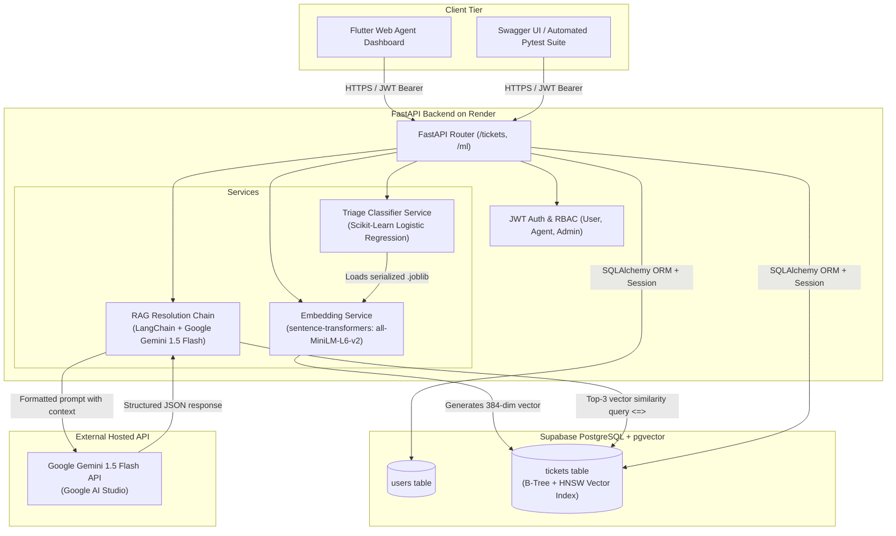
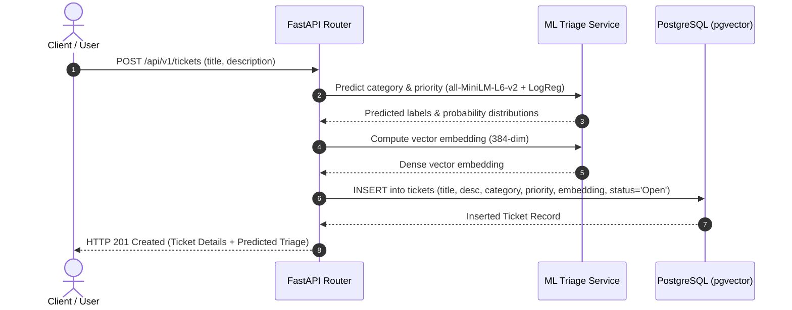
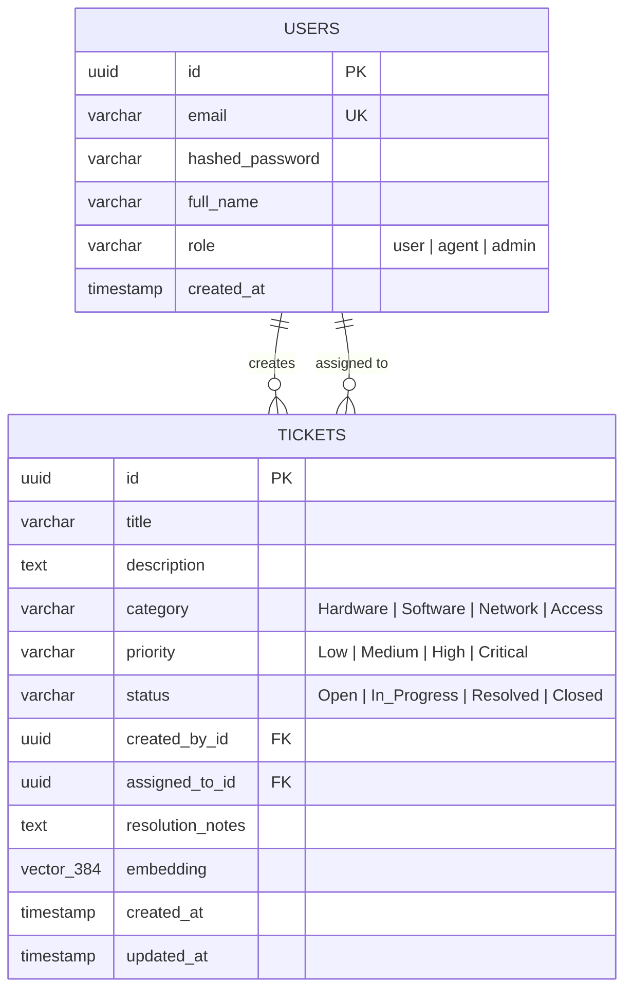

# TicketIQ — System Architecture & Design Specification

This document details the complete end-to-end architecture, database schema, API contracts, data flows, and project folder layout for **TicketIQ**, an AI IT-helpdesk triage and resolution assistant.

---

## 1. High-Level System Architecture

TicketIQ separates user-facing ticket management from machine learning inference and retrieval-augmented generation (RAG) while unifying relational ticket data and dense vector embeddings inside PostgreSQL using the `pgvector` extension.



---

## 2. Core Components

1. **Flutter Web Dashboard (Client Tier)**:
   - Support agent view: Live queue filtered by priority and category, auto-triage confirmation badge, similar tickets pane, and one-click RAG fix insertion.
   - User view: Ticket submission form with instant feedback.
2. **FastAPI Application (Application Tier)**:
   - Security: OAuth2 Password Bearer with JWT tokens (`user`, `agent`, `admin` roles).
   - Ticket Manager: Standard CRUD for tickets, statuses, assignments, and audit logs.
   - Inference Engine: Loads pre-trained `all-MiniLM-L6-v2` encoder (via `sentence-transformers`) and serialized Scikit-learn Logistic Regression models (`category_model.joblib`, `priority_model.joblib`).
   - RAG Chain Manager: LangChain orchestrator that binds retrieved context into an explainable prompt template and invokes Gemini 1.5 Flash with structured Pydantic output.
3. **Supabase PostgreSQL with `pgvector` (Data Tier)**:
   - Relational tables for Users and Tickets.
   - Dense vector column `embedding vector(384)` storing ticket textual representations.
   - HNSW index on `embedding` using `vector_cosine_ops` for fast approximate nearest neighbor (ANN) cosine distance queries.
4. **Google Gemini 1.5 Flash (LLM Provider)**:
   - Free-tier hosted LLM accessed via `langchain-google-genai`.
   - Constrained via structured JSON output parser to return strictly `{suggested_fix, sources, confidence_note}` without hallucinations.

---

## 3. Data Flows

### Flow 1: Ticket Ingestion & Auto-Triage (`POST /api/v1/tickets`)
1. User or agent submits `{title, description}`.
2. Embedding Service computes dense vector: \(\mathbf{v} \in \mathbb{R}^{384}\).
3. Triage Classifier feeds \(\mathbf{v}\) into Logistic Regression models to predict:
   - `category` (e.g., *Hardware, Software, Network, Access*)
   - `priority` (e.g., *Low, Medium, High, Critical*)
4. Ticket record is inserted into `tickets` table with `status = 'Open'`, predicted labels, and `embedding = v`.
5. Created ticket is returned with HTTP 201.



### Flow 2: Similar / Duplicate Ticket Search (`POST /api/v1/tickets/similar`)
1. Agent inputs text query or references an active ticket ID.
2. Text is converted to embedding \(\mathbf{q} \in \mathbb{R}^{384}\).
3. Query executes cosine distance lookup in PostgreSQL:
   ```sql
   SELECT id, title, description, status, resolution_notes,
          1 - (embedding <=> :q) AS similarity_score
   FROM tickets
   WHERE id != :exclude_id
   ORDER BY embedding <=> :q ASC
   LIMIT :limit;
   ```
4. Returns top-K similar historical tickets with similarity scores \(\in [0, 1]\).

### Flow 3: RAG Resolution Assistant (`POST /api/v1/tickets/{id}/suggest`)
1. Agent requests AI resolution assistance for ticket ID \(t\).
2. System fetches ticket \(t\) and retrieves top-3 historically **Resolved** tickets with cosine similarity score \(\ge 0.65\).
3. If no resolved tickets meet the threshold, chain halts early and returns a fallback message: *"No sufficiently similar resolved tickets found. Please escalate to a Senior Specialist."*
4. If similar resolved tickets exist, format context into a strict prompt template:
   - Grounding rule: Use *only* historical resolutions. Do not invent steps.
5. Invoke Gemini 1.5 Flash with structured output schema:
   ```json
   {
     "suggested_fix": "Step-by-step resolution steps...",
     "sources": [102, 189],
     "confidence_note": "Based on 2 historical tickets with >80% similarity."
   }
   ```
6. Return structured JSON payload to the agent dashboard.

---

## 4. Database Schema (PostgreSQL + pgvector)



### SQL DDL Definition

```sql
-- Enable pgvector extension
CREATE EXTENSION IF NOT EXISTS vector;

-- Users table
CREATE TABLE users (
    id UUID PRIMARY KEY DEFAULT gen_random_uuid(),
    email VARCHAR(255) UNIQUE NOT NULL,
    hashed_password VARCHAR(255) NOT NULL,
    full_name VARCHAR(255) NOT NULL,
    role VARCHAR(50) NOT NULL DEFAULT 'user' CHECK (role IN ('user', 'agent', 'admin')),
    created_at TIMESTAMP WITH TIME ZONE DEFAULT NOW()
);

-- Tickets table
CREATE TABLE tickets (
    id UUID PRIMARY KEY DEFAULT gen_random_uuid(),
    title VARCHAR(255) NOT NULL,
    description TEXT NOT NULL,
    category VARCHAR(50) NOT NULL CHECK (category IN ('Hardware', 'Software', 'Network', 'Access')),
    priority VARCHAR(50) NOT NULL CHECK (priority IN ('Low', 'Medium', 'High', 'Critical')),
    status VARCHAR(50) NOT NULL DEFAULT 'Open' CHECK (status IN ('Open', 'In_Progress', 'Resolved', 'Closed')),
    created_by_id UUID NOT NULL REFERENCES users(id) ON DELETE CASCADE,
    assigned_to_id UUID REFERENCES users(id) ON DELETE SET NULL,
    resolution_notes TEXT,
    embedding VECTOR(384),
    created_at TIMESTAMP WITH TIME ZONE DEFAULT NOW(),
    updated_at TIMESTAMP WITH TIME ZONE DEFAULT NOW()
);

-- Standard relational indexes
CREATE INDEX idx_tickets_status ON tickets(status);
CREATE INDEX idx_tickets_category ON tickets(category);
CREATE INDEX idx_tickets_priority ON tickets(priority);
CREATE INDEX idx_tickets_created_by ON tickets(created_by_id);
CREATE INDEX idx_tickets_assigned_to ON tickets(assigned_to_id);

-- HNSW Vector Index for Cosine Distance (<=>)
-- m=16 (connections per element), ef_construction=64 (build trade-off)
CREATE INDEX idx_tickets_embedding_hnsw 
ON tickets USING hnsw (embedding vector_cosine_ops)
WITH (m = 16, ef_construction = 64);
```

---

## 5. API Contracts & Specifications

All authenticated endpoints require an `Authorization: Bearer <JWT>` header.

### 5.1 Authentication Endpoints
- `POST /api/v1/auth/register`: Create a new user account.
- `POST /api/v1/auth/login`: Exchange `username` & `password` for `{access_token, token_type}`.
- `GET /api/v1/auth/me`: Retrieve current user profile and role.

### 5.2 Ticket Management Endpoints
- `POST /api/v1/tickets`:
  - Request: `{ "title": "Cannot connect to VPN", "description": "GlobalProtect gives error 502." }`
  - Response (201): Ticket object including auto-predicted `category`, `priority`, and `status: "Open"`.
- `GET /api/v1/tickets`: List tickets with query params (`status`, `category`, `priority`, `limit`, `offset`).
- `GET /api/v1/tickets/{id}`: Detailed ticket view.
- `PATCH /api/v1/tickets/{id}`: Update status, assignment, or resolution notes.

### 5.3 Machine Learning & RAG Endpoints

#### `POST /api/v1/ml/predict`
Predicts category and priority without persisting a ticket.
```json
// Request Body
{
  "title": "Broken monitor HDMI port",
  "description": "Screen flickers and turns black when connected via HDMI adapter."
}

// Response Body (200 OK)
{
  "category": "Hardware",
  "category_confidence": 0.89,
  "category_probabilities": {
    "Hardware": 0.89,
    "Software": 0.05,
    "Network": 0.04,
    "Access": 0.02
  },
  "priority": "High",
  "priority_confidence": 0.76,
  "priority_probabilities": {
    "Low": 0.04,
    "Medium": 0.20,
    "High": 0.76,
    "Critical": 0.00
  }
}
```

#### `POST /api/v1/ml/similar`
Searches historical tickets using cosine similarity over embeddings.
```json
// Request Body
{
  "text": "Outlook keeps crashing on launch after Windows update",
  "limit": 3,
  "status_filter": "Resolved"
}

// Response Body (200 OK)
{
  "query": "Outlook keeps crashing on launch after Windows update",
  "results": [
    {
      "id": "c1f7b889-4a90-48e2-bca4-d4b889412e21",
      "title": "Outlook crash on start-up",
      "description": "Office 365 Outlook terminates unexpectedly during profile load.",
      "category": "Software",
      "status": "Resolved",
      "resolution_notes": "Repaired Office installation via Add/Remove programs and re-synced profile.",
      "similarity_score": 0.912
    }
  ]
}
```

#### `POST /api/v1/ml/suggest`
Generates a grounded resolution recommendation using top-3 historical resolved tickets and Gemini 1.5 Flash.
```json
// Request Body
{
  "ticket_id": "c1f7b889-4a90-48e2-bca4-d4b889412e21"
}

// Response Body (200 OK)
{
  "ticket_id": "c1f7b889-4a90-48e2-bca4-d4b889412e21",
  "suggested_fix": "1. Run Windows Quick Repair on Microsoft 365.\n2. If issue persists, launch Outlook in safe mode (outlook.exe /safe).\n3. Rebuild the OST mail profile.",
  "sources": [
    {
      "ticket_id": "893c5fa1-...",
      "title": "Outlook crash on start-up",
      "similarity_score": 0.912
    },
    {
      "ticket_id": "147da33e-...",
      "title": "Office app error after KB update",
      "similarity_score": 0.845
    }
  ],
  "confidence_note": "Grounded in 2 historical resolved tickets with >80% semantic match."
}
```

---

## 6. Project Directory Layout

```text
TicketIQ/
├── .env.example
├── README.md
├── requirements.txt
├── Dockerfile
├── docs/
│   ├── architecture.md
│   ├── phases.md
│   ├── workflow.md
│   ├── learning_map.md
│   ├── risks.md
│   └── resume_bullets.md
├── data/
│   ├── raw/
│   │   └── customer_support_tickets.csv
│   ├── processed/
│   │   ├── train.csv
│   │   ├── test.csv
│   │   └── eval_100_heldout.csv
│   └── models/
│       ├── tfidf_vectorizer.joblib
│       ├── baseline_category_lr.joblib
│       ├── baseline_priority_lr.joblib
│       ├── embedding_category_lr.joblib
│       ├── embedding_priority_lr.joblib
│       └── label_encoders.joblib
├── notebooks/
│   ├── 01_eda_and_cleaning.ipynb
│   ├── 02_baseline_tfidf_logistic_regression.ipynb
│   ├── 03_embeddings_logistic_regression.ipynb
│   └── 04_pgvector_retrieval_and_eval.ipynb
├── backend/
│   ├── alembic/
│   │   ├── env.py
│   │   └── versions/
│   ├── alembic.ini
│   ├── app/
│   │   ├── __init__.py
│   │   ├── main.py
│   │   ├── core/
│   │   │   ├── config.py
│   │   │   └── security.py
│   │   ├── db/
│   │   │   ├── base.py
│   │   │   └── session.py
│   │   ├── models/
│   │   │   ├── user.py
│   │   │   └── ticket.py
│   │   ├── schemas/
│   │   │   ├── user.py
│   │   │   ├── ticket.py
│   │   │   └── ml.py
│   │   ├── services/
│   │   │   ├── auth_service.py
│   │   │   ├── ticket_service.py
│   │   │   └── ml/
│   │   │       ├── encoder.py         # all-MiniLM-L6-v2 wrapper
│   │   │       ├── classifier.py      # Logistic Regression predictor
│   │   │       ├── retriever.py       # pgvector cosine similarity
│   │   │       └── rag_chain.py       # LangChain + Gemini structured chain
│   │   └── api/
│   │       ├── deps.py
│   │       └── v1/
│   │           ├── router.py
│   │           ├── endpoints/
│   │           │   ├── auth.py
│   │           │   ├── tickets.py
│   │           │   └── ml.py
│   └── tests/
│       ├── conftest.py
│       ├── test_auth.py
│       ├── test_tickets.py
│       ├── test_classifier.py
│       └── test_rag_chain.py
└── frontend/
    └── ticketiq_dashboard/           # Flutter Web application (Phase 4)
        ├── pubspec.yaml
        └── lib/
            ├── main.dart
            ├── models/
            ├── providers/
            ├── services/
            └── screens/
```
